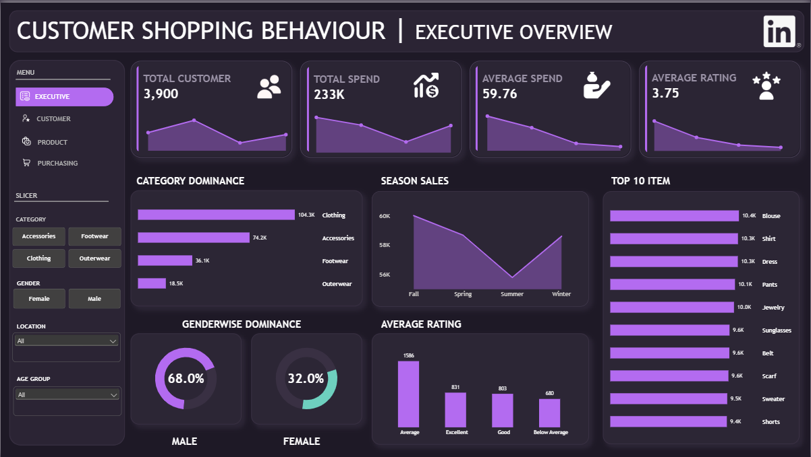
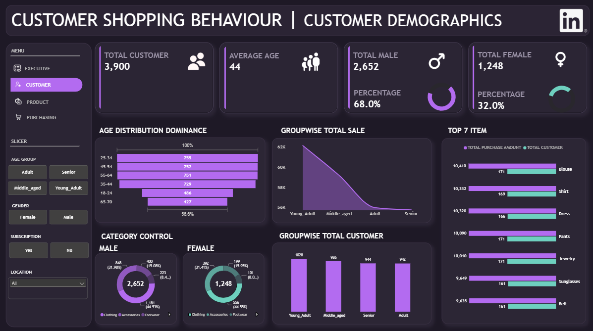
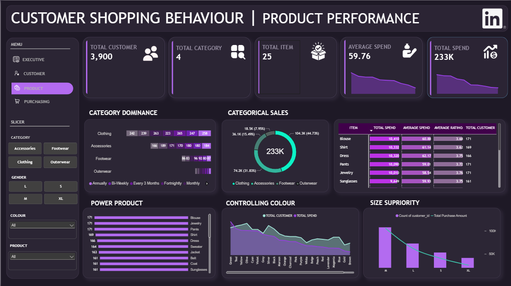
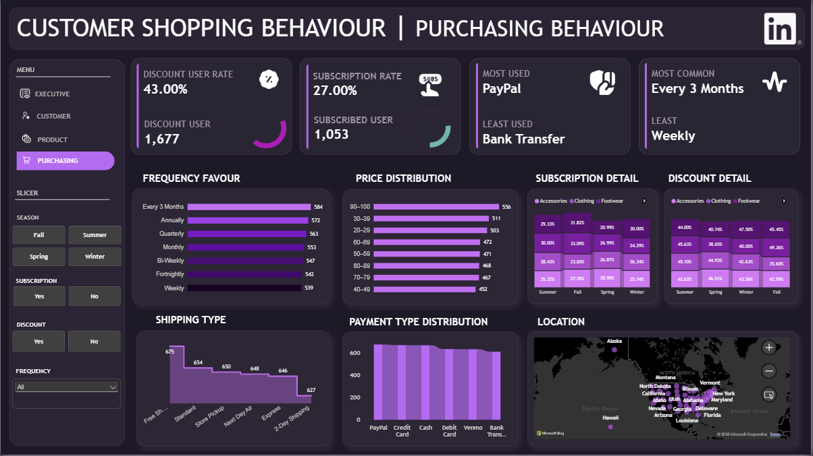

<div align="center">

# 🛍️ CUSTOMER SHOPPING BEHAVIOUR

### Turning customer records into product, purchasing and business insights.

<p>
  
  
  
  
</p>
<p>
  
  
  
  
</p>

**A complete analytics workflow — from raw CSV cleaning to MySQL analysis and an interactive four-page Power BI report.**

</div>

---

## ✦ Project at a glance

This project explores a customer shopping behaviour dataset containing **3,900 unique customer records**. It uses Python and Pandas to prepare the data, MySQL to store and analyse it, and Power BI to communicate the findings through an interactive dashboard.

The report is designed around four business questions:

| Dashboard page | The question it answers |
|:--|:--|
| **Executive Overview** | What does the overall customer and purchasing picture look like? |
| **Customer Demographics** | Who are the customers, and how are they distributed by age and gender? |
| **Product Performance** | Which categories, products, sizes and colours stand out? |
| **Purchasing Behaviour** | How do customers use discounts, subscriptions, payment methods, shipping and purchase-frequency options? |

> **The visual identity follows the Power BI report:** a deep plum canvas, elevated charcoal-purple cards, vivid lavender chart accents, teal highlights, warm amber indicators and clean white typography.

## 🎨 Dashboard design system

| Role | Colour | Hex |
|:--|:--|:--|
| Main canvas |  Deep Plum | `#211A28` |
| Visual / card surface |  Charcoal Plum | `#2D2635` |
| Primary chart accent |  Lavender | `#B46BE8` |
| Secondary accent |  Teal | `#63C9B6` |
| Attention / comparison |  Amber | `#F2B65C` |
| Main text |  Soft White | `#F7F3FA` |
| Secondary text |  Muted Lavender Grey | `#A99FB0` |

The palette is intentionally restrained: lavender carries the main comparisons, teal provides contrast, and amber/coral can be reserved for attention or satisfaction categories. Consistent colours, spacing, card borders and typography help the four pages feel like one report.

---

## 📸 Power BI dashboard preview

The report contains four pages with page-specific KPIs, visuals and slicers. Select a screenshot to view it at full size on GitHub.

### 01 — Executive Overview

A high-level snapshot of customer count, total recorded purchase amount, average purchase amount and review rating. The page brings together category contribution, seasonal purchase amount, leading products, gender composition and review-rating distribution.

<p align="center">
  <a href="executive-overview.png">
    
  </a>
</p>

**Questions answered:** Which category contributes the most? How does purchase amount vary by season? Which products lead the ranking? What is the gender composition and rating profile?

### 02 — Customer Demographics

Focuses on customer composition through total customers, average age, male/female counts and percentages, age-band distribution, quartile-based age groups, and category preference by gender.

<p align="center">
  <a href="customer-demographics.png">
    
  </a>
</p>

**Questions answered:** What does the customer base look like? Which age ranges and age groups are most represented? How does category preference compare across genders?

### 03 — Product Performance

Examines the four product categories and 25 product names through total purchase amount, purchase count, average purchase amount, ratings, top products, colour preference and size preference.

<p align="center">
  <a href="product-performance.png">
    
  </a>
</p>

**Questions answered:** Which categories and products contribute most? Which items appear most often in the records? What size and colour preferences are visible?

### 04 — Purchasing Behaviour

Explores discount usage, subscription rate, purchase-frequency labels, payment methods, shipping types, seasonal selections and location distribution.

<p align="center">
  <a href="purchasing-behaviour.png">
    
  </a>
</p>

**Questions answered:** Which payment and shipping options are most represented? How are discounts and subscriptions related in this dataset? Which purchase-frequency labels are most common?

---

## 📊 Dataset overview

The raw CSV contains **3,900 rows and 18 columns**. The prepared analytical dataset contains **3,900 rows and 19 columns** after standardising fields, removing one redundant field and adding two engineered features.

| Dataset attribute | Value |
|:--|--:|
| Customer records | **3,900** |
| Unique customer IDs | **3,900** |
| Raw columns | 18 |
| Cleaned columns | **19** |
| Product categories | 4 |
| Distinct product names | 25 |
| Locations | 50 US states |
| Product colours | 25 |
| Seasons | 4 |
| Payment methods | 6 |
| Shipping types | 6 |
| Purchase-frequency labels | 7 |
| Age range | 18–70 |

### Cleaned data dictionary

| Column | Description |
|:--|:--|
| `customer_id` | Unique customer identifier |
| `age` | Customer age in years |
| `gender` | Customer gender label |
| `item_purchased` | Product name recorded for the customer |
| `category` | Product category: Clothing, Accessories, Footwear or Outerwear |
| `purchase_amount` | Recorded purchase amount in USD |
| `location` | US state associated with the customer record |
| `size` | Product size label (S, M, L or XL) |
| `color` | Recorded product colour |
| `season` | Season label: Spring, Summer, Fall or Winter |
| `review_rating` | Customer review rating on a 1–5 scale |
| `subscription_status` | Whether the customer is marked as subscribed |
| `shipping_type` | Selected shipping method |
| `discount_applied` | Whether a discount is marked as applied |
| `previous_purchases` | Previous-purchase count supplied in the dataset |
| `payment_method` | Recorded payment method |
| `frequency_of_purchases` | Categorical purchase-frequency label |
| `age_group` | Four groups created from age quartiles |
| `purchase_frequency_days` | Estimated day interval mapped from purchase-frequency labels |

---

## 🧹 Data cleaning and preparation

The raw data was inspected, cleaned, validated and enriched using **Python and Pandas** before being exported and loaded into MySQL.

### Preparation steps

1. **Initial inspection:** reviewed sample records, dimensions, column names, data types, descriptive statistics and missing-value counts.
2. **Missing review ratings:** the raw data contained 37 missing values in `review_rating`; these were filled using the median rating within the corresponding product category.
3. **Column standardisation:** converted field names to consistent snake_case naming.
4. **Redundant-field removal:** removed `promo_code_used` because it matched `discount_applied` across all 3,900 records.
5. **Age-group feature:** added `age_group` using four approximately equal-sized age quartiles with `pandas.qcut()`.
6. **Purchase-frequency feature:** added `purchase_frequency_days` using a mapping from the categorical frequency labels.
7. **Validation:** checked missing values, duplicate rows, duplicate customer IDs, numeric ranges, IQR outliers, categorical whitespace and cross-column consistency.
8. **Export:** saved the prepared data to a separate cleaned CSV, preserving the raw CSV.

### Data-quality results

| Validation | Result |
|:--|--:|
| Missing values after cleaning | **0** |
| Duplicate rows | **0** |
| Duplicate customer IDs | **0** |
| Invalid age values in the applied range check | **0** |
| Non-positive purchase amounts | **0** |
| Review ratings outside 1–5 | **0** |
| Negative previous-purchase counts | **0** |
| IQR outliers flagged in checked numeric columns | **0** |
| Leading/trailing whitespace in checked categorical fields | **0** |
| Unmapped purchase-frequency values | **0** |
| Product names mapped to multiple categories | **0** |

### Engineered feature definitions

**Age quartiles**

| `age_group` | Age range observed in this dataset |
|:--|:--:|
| `Young_Adult` | 18–31 |
| `Adult` | 32–44 |
| `Middle_aged` | 45–57 |
| `Senior` | 58–70 |

These labels are dataset-derived quartile groups, not universal demographic definitions. A separate fixed-band age distribution is also used in the Power BI demographic page.

**Purchase-frequency day mapping**

| Source label | Mapped days |
|:--|--:|
| Weekly | 7 |
| Fortnightly | 14 |
| Bi-Weekly | 14 |
| Monthly | 30 |
| Quarterly | 90 |
| Every 3 Months | 90 |
| Annually | 365 |

The day values are analytical approximations mapped from categorical labels. They are not calculated from actual transaction timestamps.

---

## 🧮 SQL analysis performed

The cleaned dataset was uploaded to the MySQL database **`customer_behavior`**, in the table **`customer`**. SQL analysis covered descriptive summaries, grouped comparisons, subqueries, CTEs, joins, conditional logic and window functions.

| Analysis area | Questions / techniques used |
|:--|:--|
| Dataset overview | Record count, unique customers, age range, total and average purchase amount, average rating |
| Gender and age | Gender share, age-group distribution, age-group × gender segmentation |
| Categories | Purchase count, total purchase amount, average amount and category contribution |
| Products | Product ranking, top products within category using `DENSE_RANK()` |
| Purchase preferences | Size and colour distribution, purchase count and purchase amount |
| Purchasing choices | Payment method, shipping type, subscription and discount comparisons |
| Seasonality | Seasonal purchase amount and category-by-season comparisons |
| Geography | Location ranking by total purchase amount |
| Satisfaction | Rating bands created with `CASE WHEN` |
| Advanced segmentation | Purchase-value tiers created with `NTILE(3)` |
| Cross-analysis | Gender × category and subscription × discount |

### Example SQL patterns

<details>
<summary><strong>Customer count and purchase summary</strong></summary>

```sql
SELECT
    COUNT(*) AS total_records,
    COUNT(DISTINCT customer_id) AS unique_customers,
    ROUND(AVG(age), 2) AS average_age,
    SUM(purchase_amount) AS total_purchase_amount,
    ROUND(AVG(purchase_amount), 2) AS average_purchase_amount,
    ROUND(AVG(review_rating), 2) AS average_review_rating
FROM customer;
```
</details>

<details>
<summary><strong>Category contribution</strong></summary>

```sql
SELECT
    category,
    COUNT(*) AS total_purchases,
    SUM(purchase_amount) AS total_purchase_amount,
    ROUND(AVG(purchase_amount), 2) AS average_purchase_amount,
    ROUND(
        SUM(purchase_amount) * 100.0 /
        (SELECT SUM(purchase_amount) FROM customer),
        2
    ) AS purchase_amount_share
FROM customer
GROUP BY category
ORDER BY total_purchase_amount DESC;
```
</details>

<details>
<summary><strong>Rank products within each category</strong></summary>

```sql
WITH product_summary AS (
    SELECT
        category,
        item_purchased,
        COUNT(*) AS total_purchases,
        SUM(purchase_amount) AS total_purchase_amount
    FROM customer
    GROUP BY category, item_purchased
),
ranked_products AS (
    SELECT
        *,
        DENSE_RANK() OVER (
            PARTITION BY category
            ORDER BY total_purchase_amount DESC
        ) AS product_rank
    FROM product_summary
)
SELECT *
FROM ranked_products
WHERE product_rank <= 3
ORDER BY category, product_rank;
```
</details>

---

## 🏆 Key business findings

The following findings are based on the SQL outputs and the completed Power BI analysis.

### 1. Overall performance

| Metric | Result |
|:--|--:|
| Customer records / unique IDs | **3,900** |
| Total recorded purchase amount | **$233,081** |
| Average recorded purchase amount | **$59.76** |
| Average review rating | **3.75 / 5** |
| Average customer age | **44.07 years** |

### 2. Customer demographics

- Male customers represent **68%** (2,652) of the records; Female customers represent **32%** (1,248).
- `Young_Adult` is the largest quartile-based age group with **1,028** customers.
- Young Adults contribute **$62,143**, or **26.66%** of the total recorded purchase amount.
- Young Adult Male is the largest age-group/gender combination (**703** records; **$42,001** total purchase amount).
- Young Adult Female has the highest average purchase amount among the eight demographic combinations (**$61.98**) and the highest average rating (**3.81**).

### 3. Product and category performance

- **Clothing** leads with **1,737** purchase records and **$104,264** total recorded purchase amount (**44.73%** of the total).
- Clothing and Accessories together contribute **76.57%** of the total recorded purchase amount.
- **Blouse** leads the supplied top-product ranking with **$10,410**.
- **Dress** has the highest average purchase amount among the top 10 products (**$62.17**).
- Category leaders by total purchase amount: Jewelry (Accessories), Blouse (Clothing), Shoes (Footwear) and Coat (Outerwear).

### 4. Purchasing preferences

- **Medium** is the most common size (**45%**, 1,755 records); Medium and Large together account for **72%**.
- **Olive** is the most frequently recorded colour (**177** records).
- **Green** has the highest total recorded purchase amount by colour (**$11,104**) and highest average amount (**$65.70**).
- **PayPal** is the most-used payment method (**677**, 17.36%); Credit Card has the highest total amount (**$40,310**).
- **Free Shipping** is the most frequent shipping option (**675**, 17.31%).
- **Every 3 Months** is the most represented purchase-frequency label (**584**, 14.97%).

### 5. Seasonal patterns

- **Fall** has the highest seasonal total purchase amount (**$60,018**) and highest average purchase amount (**$61.56**).
- **Spring** has the highest customer count (**999**, 25.62%) and highest average rating (**3.79**).
- Fall leads Accessories and Outerwear by total purchase amount; Spring leads Clothing and Footwear.
- Seasonal values are categorical comparisons. The dataset has no transaction date field for a chronological time-series trend.

### 6. Customer satisfaction

| Rating segment | Customers | Share |
|:--|--:|--:|
| Excellent (≥ 4.5) | 831 | 21.31% |
| Good (4.0 to < 4.5) | 803 | 20.59% |
| Average (3.0 to < 4.0) | 1,586 | 40.67% |
| Below Average (< 3.0) | 680 | 17.44% |

The largest segment is **Average**. Good and Excellent together account for **41.90%** of records. Review ratings include the 37 values imputed using category-wise medians.

### 7. Subscription and discounts

- **27%** (1,053) of customers are marked as subscribed.
- **43%** (1,677) of records have a discount applied.
- Every subscribed customer in this dataset has `discount_applied = Yes` (**1,053 of 1,053**).
- Among non-subscribed customers, **624 of 2,847** (21.92%) have a discount applied.

This is a notable association in the dataset, but it does not prove that subscription causes discount eligibility or vice versa.

### 8. Purchase-value segmentation

| Segment | Customers | Total purchase amount | Average amount | Average rating |
|:--|--:|--:|--:|--:|
| High | 1,300 | $113,366 | $87.20 | 3.77 |
| Medium | 1,300 | $77,619 | $59.71 | 3.75 |
| Low | 1,300 | $42,096 | $32.38 | 3.73 |

The High segment contributes approximately **48.64%** of the total recorded purchase amount. Its average rating is only **0.04 points** above the Low segment; this is a small descriptive difference, not evidence of a meaningful or causal relationship.

---

## 💡 Business recommendations

| Focus area | Recommended action |
|:--|:--|
| Category planning | Monitor Clothing and Accessories closely because together they contribute over three-quarters of recorded purchase amount. |
| Product strategy | Review the leading products in each category and evaluate margins before making inventory decisions. |
| Customer experience | Investigate products and service experiences associated with lower review ratings. |
| Subscription programme | Examine subscription rules and discount eligibility; test whether subscription benefits improve retention with longitudinal data. |
| Seasonal planning | Use the observed category-season patterns as hypotheses for inventory and campaign planning, then validate with additional periods. |
| Size and colour | Review demand by size and colour to support assortment planning; purchase records are not stock-on-hand data. |
| Further measurement | Collect order IDs, transaction dates, item quantities, product costs, returns and repeat transactions to improve profitability and retention analysis. |

---

## 🛠️ Tools and technologies

| Tool | Role in this project |
|:--|:--|
| **Python** | Data loading, inspection and preprocessing |
| **Pandas** | Data cleaning, validation and feature engineering |
| **MySQL** | Storage and structured SQL analysis |
| **SQLAlchemy** | Python-to-MySQL engine and connection interface |
| **PyMySQL** | MySQL database driver for Python |
| **python-dotenv** | Loads local database credentials from `.env` |
| **Power BI Desktop** | Interactive dashboard and data visualization |
| **DAX** | KPI measures and calculated columns |
| **Jupyter Notebook** | Reproducible cleaning and preparation workflow |

---

## 🚀 Reproduce the project

### Prerequisites

- Python 3.x
- Jupyter Notebook or VS Code with the Jupyter extension
- MySQL Server and MySQL Workbench
- Power BI Desktop
- MySQL Connector/NET for the Power BI MySQL connector

### 1. Clone the repository

```bash
git clone <your-repository-url>
cd CUSTOMER_SHOPPING_BEHAVIOUR
```

### 2. Install Python dependencies

```bash
pip install pandas numpy sqlalchemy pymysql python-dotenv jupyter
```

### 3. Configure local MySQL credentials

Create a local `.env` file in the project root. Do **not** commit this file.

```env
DB_USERNAME=root
DB_PASSWORD=your_local_mysql_password
DB_HOST=localhost
DB_PORT=3306
DB_NAME=customer_behavior
```

Keep a placeholder-only `.env.example` in the repository so another user can create their own local `.env` file.

### 4. Create the MySQL database

Run this once in MySQL Workbench:

```sql
CREATE DATABASE IF NOT EXISTS customer_behavior;
```

The Python upload step creates the `customer` table. The database itself must exist first.

### 5. Load credentials and create the SQLAlchemy engine

```python
import os
from pathlib import Path
from dotenv import load_dotenv
from sqlalchemy import create_engine, URL

load_dotenv(Path.cwd() / ".env")

username = os.getenv("DB_USERNAME")
password = os.getenv("DB_PASSWORD")
host = os.getenv("DB_HOST")
port = int(os.getenv("DB_PORT", "3306"))
database = os.getenv("DB_NAME")

if not all([username, password, host, database]):
    raise ValueError("Missing MySQL credentials. Check the local .env file.")

connection_url = URL.create(
    "mysql+pymysql",
    username=username,
    password=password,
    host=host,
    port=port,
    database=database,
)

engine = create_engine(connection_url)
```

### 6. Upload the cleaned DataFrame

After executing the cleaning notebook and confirming that `df` contains the cleaned dataset:

```python
df.to_sql(
    name="customer",
    con=engine,
    if_exists="replace",
    index=False,
)
```

> **Important:** `if_exists="replace"` drops and recreates an existing table named `customer`. Use it only when replacing that table is intentional. Keep the raw CSV unchanged and export the cleaned CSV separately.

### 7. Connect Power BI to MySQL

In Power BI Desktop:

1. Select **Home → Get Data → MySQL database**.
2. Enter server `localhost:3306`.
3. Enter database `customer_behavior`.
4. Choose **Import** mode.
5. Select **Database** authentication and enter your own MySQL username and password.
6. Select the `customer` table in Navigator and load it.

Power BI uses the MySQL connector; installing PyMySQL for Python is not a replacement for the MySQL Connector/NET component required by the Power BI Desktop connector.

---

## 📁 Suggested repository structure

```text
CUSTOMER_SHOPPING_BEHAVIOUR/
│
├── DATASET/
│   ├── customer_shopping_behavior_raw.csv
│   └── customer_shopping_behavior_cleaned.csv
│
├── SQL/
│   ├── 01_database_setup.sql
│   ├── 02_exploratory_analysis.sql
│   ├── 03_product_analysis.sql
│   └── 04_advanced_segmentation.sql
│
├── assets/
│   ├── executive-overview.png
│   ├── customer-demographics.png
│   ├── product-performance.png
│   └── purchasing-behaviour.png
│
├── DOCUMENTATION/
│   └── KEY_INSIGHT.md
│
├── CUSTOMER_SHOPPING_BEHAVIOUR.ipynb
├── CUSTOMER_SHOPPING_BEHAVIOUR.pbix
├── .env.example
├── .gitignore
└── README.md
```

The `SQL/`, `DOCUMENTATION/` and `.pbix` entries represent a recommended organization for the deliverables. Include them when you have saved those files in your local project.

### Suggested `.gitignore`

```gitignore
# Secrets
.env
*.env

# Python cache and local environments
__pycache__/
*.py[cod]
.venv/
venv/

# Jupyter temporary files
.ipynb_checkpoints/

# Local system files
.DS_Store
Thumbs.db
```

Do not commit database passwords, local connection strings containing credentials, or other secrets. If a real password was ever committed, rotate it; deleting the latest copy does not remove it from Git history.

---

## ⚠️ Interpretation notes and limitations

- **One record per customer:** There are 3,900 rows and 3,900 unique customer IDs. Purchase count in this dataset is a count of customer records associated with an item or category; it is not a count of repeated transactions by the same customer.
- **Purchase amount vs. product price:** `purchase_amount` is the recorded purchase amount for a customer record. The dataset does not provide unit price or item quantity, so it cannot support a true average product-price calculation. The Power BI purchase-amount bands are ranges of recorded purchase amounts, not unit-price bands.
- **Purchase frequency:** Frequency labels are supplied categories. The added day mapping is approximate and does not measure elapsed time between actual dated transactions.
- **Seasonality:** There is a `season` label but no transaction-date column. Seasonal charts compare categories; they should not be described as a chronological trend.
- **Customer value:** `NTILE(3)` segments the single recorded purchase amount per customer. It is not Customer Lifetime Value (CLV).
- **Ratings:** 37 missing ratings were imputed using category-wise medians. Rating analysis includes these imputed values.
- **Profitability:** Purchase amount is not profit or margin. Cost, discount value, shipping cost and returns are not available.
- **Causality:** Group differences are descriptive associations, not causal evidence.
- **Outerwear products:** The dataset has two distinct Outerwear products (Coat and Jacket), so a top-three ranking can return only two items for that category.
- **Ties in `NTILE(3)`:** Equal purchase amounts can fall into adjacent tiers at a bucket boundary because `NTILE` balances row counts. A deterministic customer-ID tie-breaker makes ordering repeatable but does not keep tied values in one tier.

---

## 👤 Author

**Piyush Kumar**  
B.Tech — Computer Science and Engineering  
Data Analytics · SQL · Python · Power BI

---

<div align="center">

### ✦ From customer data to clearer decisions ✦


**Customer Shopping Behaviour Analysis**

</div>

